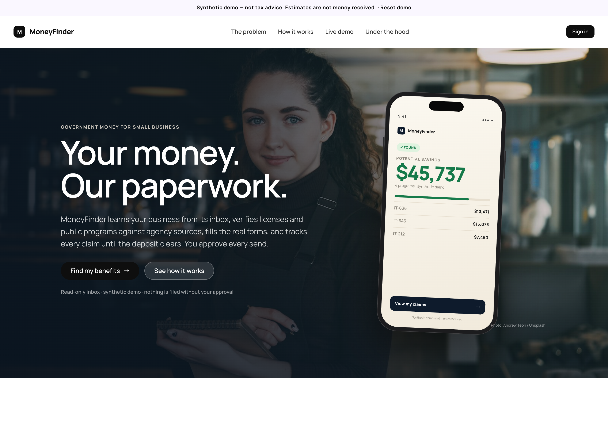
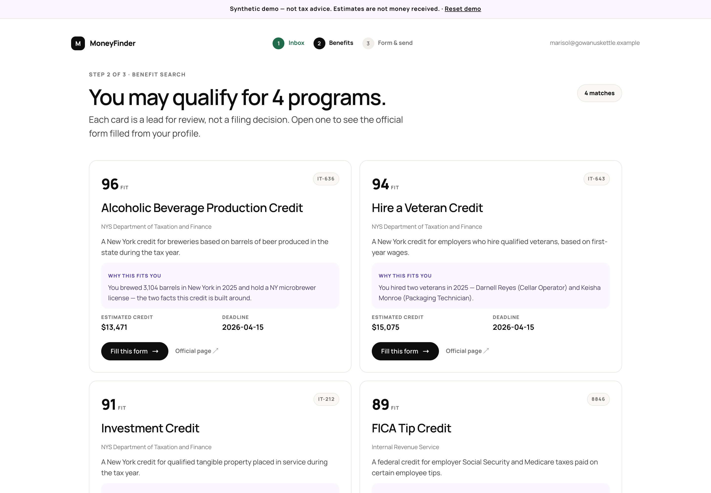
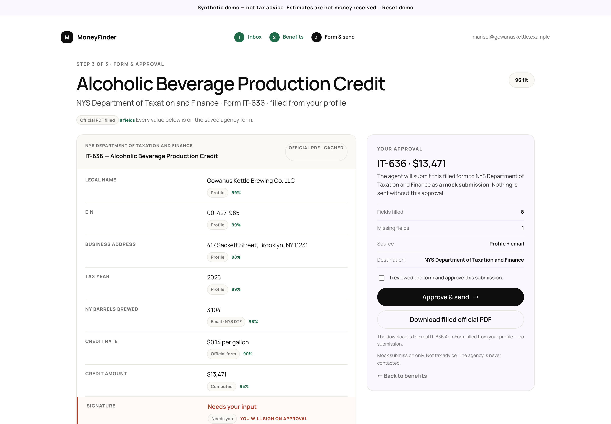
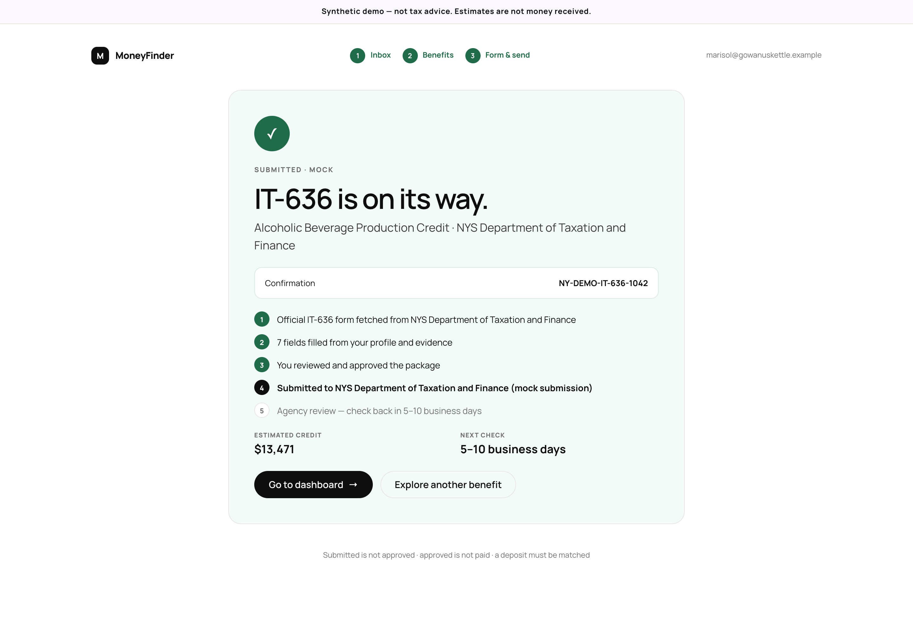
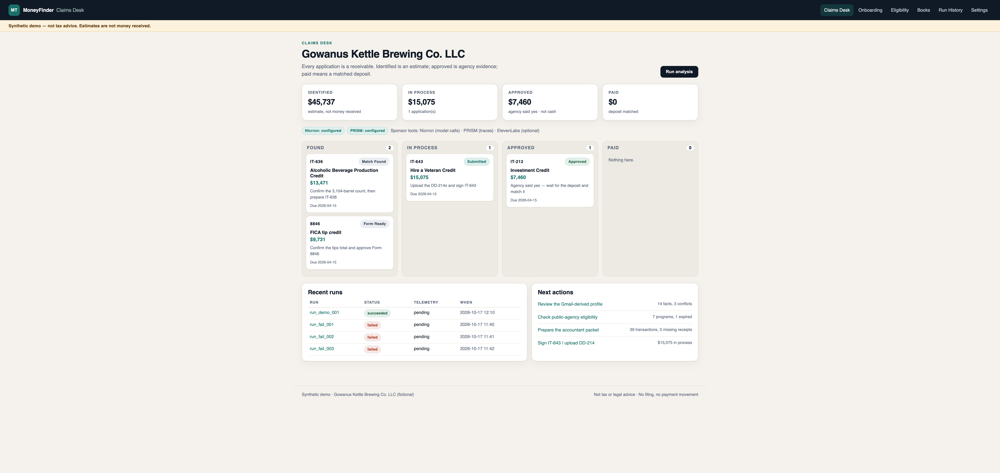
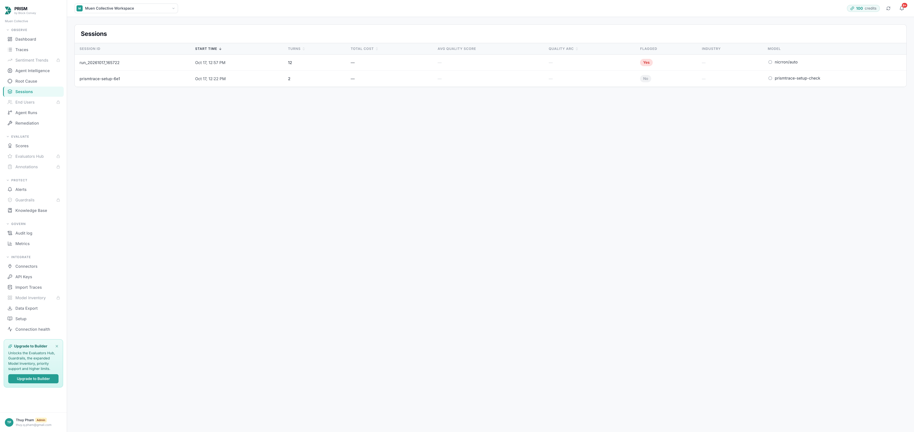

# MoneyFinder Claims Desk

**Live demo:** https://hackathon-lab.vercel.app

**MONEY TALKS 2 · Money Operations track · October 17, 2026**

> Your business is leaving tax credits and rebates on the table. MoneyFinder learns the business from its inbox, checks public-agency eligibility with citations, fills the paperwork with provenance, tracks every application until the deposit clears, and prepares the accountant packet — without ever pretending an estimate is money received.

**Synthetic demo.** Gowanus Kettle Brewing Co. LLC is fictional (`.example` domain, `00-` EIN, 555-01xx phone). Not tax or legal advice. No filing, no payment movement, no agency submission.

---

## What runs today

| Screen | What it shows | Data source |
|---|---|---|
| `/` | Landing page + public nav | static |
| `/signin` | Demo auth (email only), session, guarded routes | demo user |
| `/onboarding` | Google SSO → **Gmail permission modal** → **Gmail crawl** → **profile builder** → profile review → **verification** (SLA/DOS/zoning/tax) → benefit cards → **real PDF fill** (PDF.js + pypdf) → approval → progress | onboarding fixture + inbox + `fixtures/verification.json` + `fixtures/forms/` |
| `/dashboard` | Four-column claims desk: Found / In process / Approved / Paid; totals; next actions | applications fixture |
| `/applications/<id>` | Amount, evidence, event log, allowed status transitions | fixture + status machine |
| `/eligibility` | 7 programs with verdicts, citations, `as_of`; WOTC flagged expired | cached official-page excerpts |
| `/books` | 39-transaction ledger, exceptions, accountant packet download (Markdown/CSV/XLSX) | synthetic ledger |
| `/run-history` | 12-step run, local vs PRISM, telemetry status, failed-run cluster | runs fixture + live runs |
| `/settings` | integration status, modes, reset demo | env + fixtures |

Everything is backed by **fixtures**, so the demo works with no network, no model key and no PRISM key. With keys, the same run emits real **Nicrron** calls and **PRISM** traces.

## Provenance

Every public number on the landing page is sourced in [`docs/PROVENANCE.md`](docs/PROVENANCE.md), including the 2011 $15B tax-credit estimate, the derived 89%/11% split, and the personal unclaimed-funds headlines.

## Reuse from `thetradingdoc/moneyfinder`

| Piece | Richard's source | Status in this app |
|---|---|---|
| Gmail OAuth + read-only scrape | `research/business/.../gmail/`, `email_facts.py` | **Not ported** (needs Google OAuth client + callback routes); synthetic inbox is used for the demo |
| Benefits catalog / official-page crawl | `research/legal/` (`legal-research run --search`) | **Fixtures today**; catalog/search can replace `programs.json` |
| Official PDF fill | `form-filling/demo_forms.py` (pypdf) | **Ported** → `app/services/pdf_fill.py`, blank PDFs in `fixtures/forms/` |
| Anchor browser fill + live view | `form-filling/fill_pdf.py` | Not ported (needs `ANCHOR_API_KEY`); useful for the recording |
| Synthetic demo business/inbox | `demo/gowanus-kettle/` | Reused as this app's fixtures |

## Reset the demo

The onboarding state is server-side; to restart from the Gmail consent screen:

- **UI:** click **Reset demo** in the top banner on any screen (one click; clears session + fixtures), or
- **Settings → Reset demo state** (keeps you signed in), or
- **API:** `curl -X POST http://127.0.0.1:8000/api/demo/reset`

Then go to `/signin` (or `/onboarding`) and run the flow again.

## Team access

- **Repo:** https://github.com/muen-dev/hackathon-lab
- **Branches:** `feat/thuy-onboarding-prism` · `feat/kenan-desk-books` · `feat/richard-ledger-agent`
- **Docs:** [PRD](docs/PRD.md) · [Epic](docs/EPIC.md) · [Contract](docs/CONTRACT.md) · [Team plan](docs/TEAM_PLAN.md) · [Architecture](docs/ARCHITECTURE.md)
- **Live demo:** run `make run` at http://127.0.0.1:8000, or ask Thuy for the current temporary tunnel link.

## Screenshots








Design system + component specs: [DESIGN.md](DESIGN.md) · User-flow epic: [docs/EPIC_UI_FLOW.md](docs/EPIC_UI_FLOW.md).

## Quickstart

```bash
cp .env.example .env          # fill keys locally; .env is gitignored
make setup                    # uv venv + deps
make run                      # http://127.0.0.1:8000
make test                     # 12 tests
```

Manual setup:

```bash
python3 -m venv .venv
.venv/bin/pip install -r requirements.txt
.venv/bin/python run.py
```

## Demo path (2 minutes)

1. `/dashboard` — “$45,737 identified, $15,075 in process, $7,460 approved, $0 paid.” Point at the money semantics.
2. `/onboarding` — scan; show facts with source quotes; resolve the coral conflicts; consent.
3. `/eligibility` — IT-636/212/643/8846 eligible with citations; **WOTC expired**; NYSERDA needs one question.
4. `/applications/app_it643` — in process, missing DD-214, next action; move a status; show the event log.
5. `/books` — 39 transactions, 3 missing receipts, 1 duplicate; build and download the accountant packet.
6. `/run-history` — 12 steps; telemetry `ok` after PRISM; v1 failed-run cluster and v2.
7. `/settings` — Nicrron/PRISM status, reset demo.

## Architecture

```
Browser (Jinja pages + JSON API)
  └── Flask app (app/)
       ├── routes/pages.py, routes/api.py        — screens + contract
       ├── services/orchestrator.py              — 12-step run, one PRISM session
       ├── services/evidence.py                  — inbox → facts/conflicts
       ├── services/eligibility.py               — program verdicts + citations
       ├── services/applications.py              — status machine + pipeline
       ├── services/ledger.py, packet.py          — money math, exceptions, packet
       ├── services/nicrron.py                   — OpenAI-compatible client
       ├── services/prism.py                     — trace per step, honest telemetry
       └── store.py                              — fixtures, reset, events, tasks
```

- **One run = one PRISM session** (`agent_id=moneyfinder-backoffice`), one trace per tool step.
- **Money math is code**, integer cents; identified ≠ approved ≠ paid; `PAYMENT_ISSUED` ≠ `PAYMENT_CONFIRMED`.
- **No source, no fact**; conflicts are preserved, never silently resolved.
- **Nicrron failure is explicit**; no silent fixture fallback after an API call.

## Sponsor integrations

| Tool | Status | Detail |
|---|---|---|
| **Nicrron** (required) | verified | `https://api.nicrron.ai/v1`, `nicrron/auto`; live call verified; $260 credits |
| **PRISM** (required) | connected | project `6e1051f7-8dce-498f-9846-d6acaa087737`; span-level traces: 1 agent + 12 tool + 1 LLM per run; alert rule active. Evaluation key still needs configuring in PRISM. |
| **ElevenLabs** (optional) | P2 | spoken claims summary; not in the demo spine |

PRISM proof plan: 50+ runs, a 12-step session, the alert firing on a failed tool/partial run, a 3+ failed-run root-cause cluster, and v2 passing the same inputs. Run History only shows a PRISM link after verification — never a fabricated one.

## API

`GET /api/health` · `POST /api/demo/reset` · `GET /api/profile` · `GET /api/inbox` · `GET /api/messages/<id>` · `GET /api/applications` · `GET /api/applications/<id>` · `POST /api/applications/<id>/transition` · `GET /api/eligibility` · `GET /api/ledger` · `GET /api/ledger/exceptions` · `POST /api/ledger/packet` · `GET /api/ledger/packet/<packet>/<file>` · `POST /api/analysis/run` · `GET /api/runs` · `GET /api/runs/<id>` · `GET /api/integrations/status` · `GET /api/voice/summary`

All responses are JSON with `synthetic: true` in demo mode.

## Fixtures

`fixtures/` is the demo dataset: `business.json`, `profile.json` (facts/conflicts/messages), `applications.json`, `programs.json`, `ledger.json`, `runs.json`. Regenerate with `make fixtures` (source: the synthetic Gowanus Kettle inbox). To use another business, replace the fixtures — the services do not assume Gowanus.

## Tests

```bash
make test
# 12 passed: pages, API, status machine, deposit gate, ledger math, packet, reset
```

## Team

| Person | Owns | Branch |
|---|---|---|
| Thuy | PRISM proofs, onboarding/dashboard/eligibility/books UI, repo | `feat/thuy-onboarding-prism` |
| Kenan | UI shell, transactions/books, demo video + pitch | `feat/kenan-desk-books` |
| Richard | API, orchestrator, ledger/packet, Nicrron/PRISM | `feat/richard-ledger-agent` |

See `docs/TEAM_PLAN.md` and `docs/CONTRACT.md`.

## Honesty rules

- Synthetic data only; no real Gmail, bank or agency connection.
- “Identified” is an estimate; “approved” is not cash; “paid” requires a matched deposit.
- Good-faith eligibility leads cite the official page; a lapsed program is blocked.
- No filing, no email sending, no transaction changes, no third-party submission.
- The accountant remains the professional; the packet says **prepared for review, not filed**.
